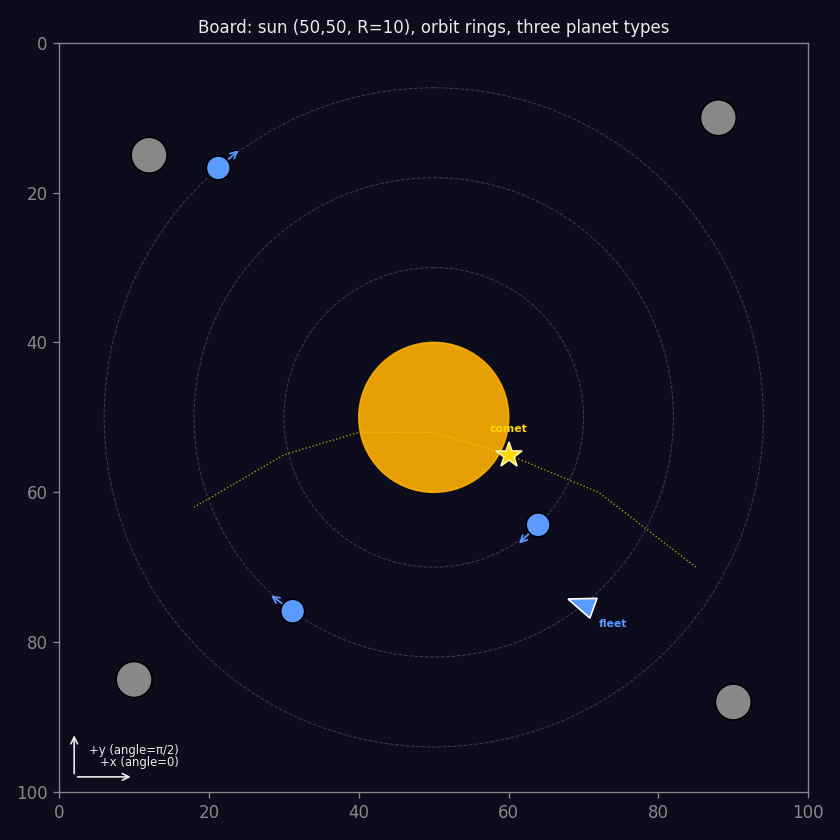
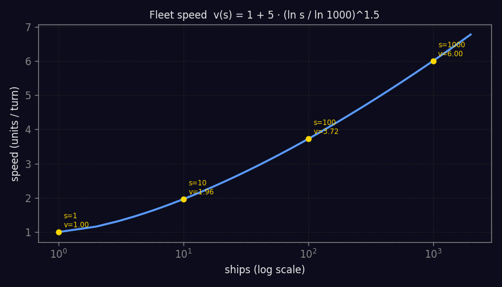
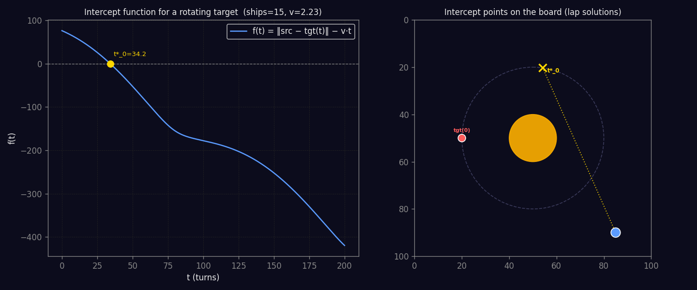
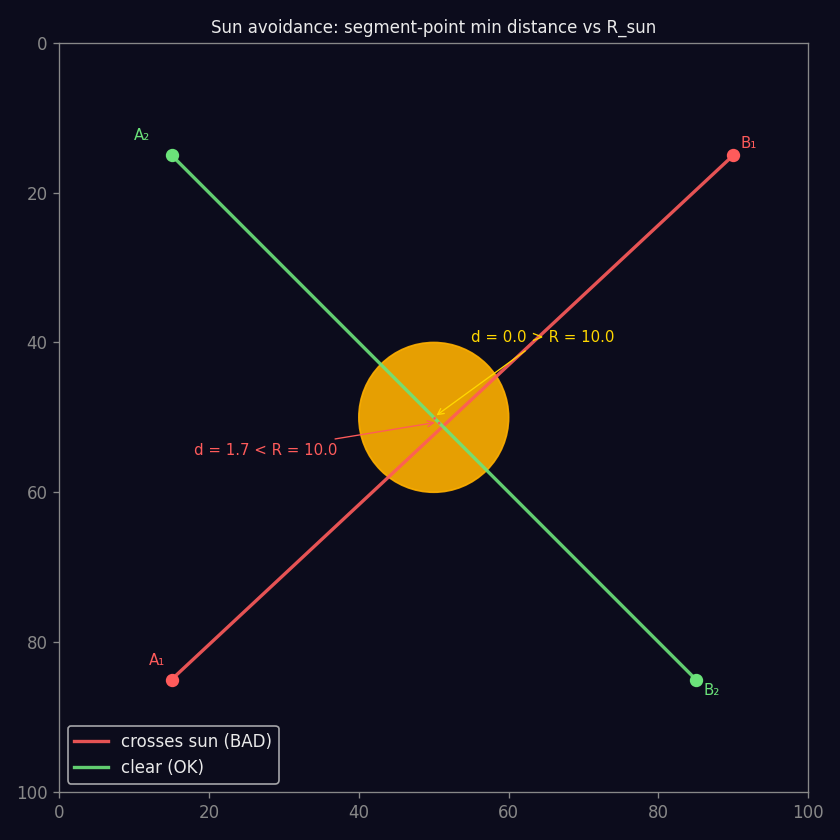
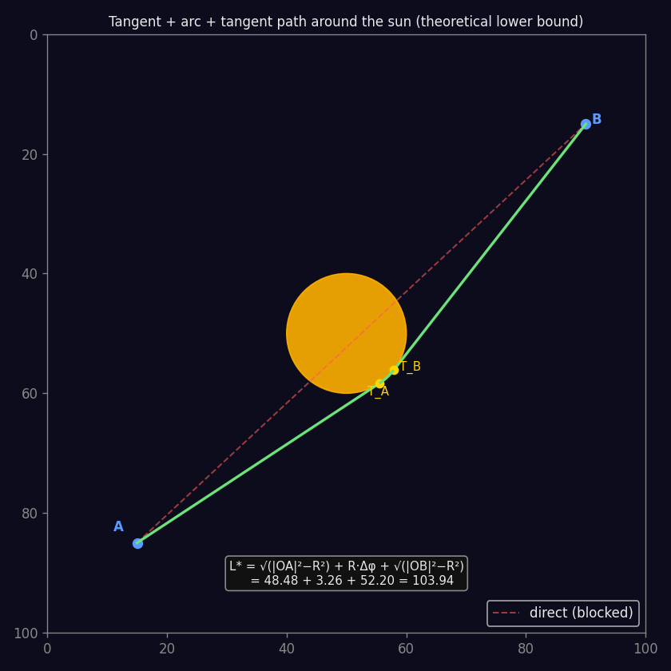

# Orbit Wars — Matematiksel Çerçeve

Bu belge `feature_extraction.py`, `navigation.py` ve `playground.py`'deki formüllerin arkasındaki matematiği tek yerde toplar. Görseller `docs/generate_figures.py` ile üretilir:

```bash
python docs/generate_figures.py
```

---

## 1. Koordinat Sistemi

Oyun tahtası `100 × 100` bir karedir.

- **Sun (güneş)**: `O = (50, 50)`, yarıçap `R_sun = 10`. Hiçbir şey içinden geçemez.
- **+x ekseni**: sağa.
- **+y ekseni**: **aşağı** (ekran koordinatları; `angle = π/2` aşağıyı gösterir).
- **Açı referansı**: `atan2(dy, dx)`, `[-π, π]` aralığı.

**Polar koordinat (güneş merkezli)**:

$$
r = \sqrt{(x - 50)^2 + (y - 50)^2}, \quad
\theta = \operatorname{atan2}(y - 50,\, x - 50)
$$

Rotating gezegenler için `r` değişmezdir (yörünge dairesel); sadece `θ` zamana bağlı artar.



---

## 2. Gezegen Tipleri ve Hareket Modelleri

Env üç tip gezegen tutar:

### 2.1 Statik

Hareketsiz. `position(t) = (x, y)` her zaman.

**Sınıflama kuralı**: `r_sun + r_planet ≥ 50` ise statik.

### 2.2 Rotating (Yörüngede)

Güneş etrafında sabit yarıçaplı dairesel yörüngede dönerler, **tüm yörüngedekiler aynı açısal hızla** `ω` döner.

$$
\theta(t) = \theta_0 + \omega \cdot t
$$

$$
\text{pos}(t) = \bigl(50 + r \cos\theta(t),\; 50 + r \sin\theta(t)\bigr)
$$

**Sınıflama kuralı**: `r_sun + r_planet < 50` ve comet değil.

**Tangential hız** (yörüngedeki çizgisel hız):

$$
v_\perp = \omega \cdot r
$$

Bu, yakalanabilirlik için önemli: `v_{\text{fleet}} > v_\perp` olmalı, yoksa filo hedefi hiç tutamaz.

### 2.3 Comet (Kuyrukluyıldız)

Önceden hesaplanmış **elips path** üzerinde hareket ederler. `path` bir `(x, y)` noktaları dizisi, `path_index` mevcut indeks. Her tur `path_index += 1`.

$$
\text{pos}(t) = \text{path}[\text{path\_index} + \lfloor t \rfloor \cdot s_{\text{comet}}]
$$

Lineer enterpolasyon ile kesirli `t` desteklenir. Path'in sonuna varan comet ortadan kaybolur (time to live bitmiş).

---

## 3. Filo Kinematiği

Bir filo fırlatıldığı andan itibaren **sabit yön + sabit hızla düz çizgide** hareket eder. Yön değiştiremez.

### 3.1 Hız Formülü

$$
v(s) = 1 + (v_{\max} - 1) \cdot \left(\frac{\ln s}{\ln 1000}\right)^{1.5},
\quad v_{\max} = 6,\ s \ge 2
$$

Kenar durumlar: `v(0) = 0`, `v(1) = 1`.



| ships | speed | yorum |
|-------|-------|-------|
| 1     | 1.00  | en yavaş, keşif filosu |
| 10    | 2.38  | tipik küçük filo |
| 100   | 3.80  | orta boy |
| 1000  | 6.00  | teorik maksimum |

### 3.2 Konum Tahmini

Lineer hareket, trivial:

$$
\text{pos}(t) = (f_x + v \cos(\alpha) \cdot t,\; f_y + v \sin(\alpha) \cdot t)
$$

---

## 4. Lead Shot — İntercept Denklemi

**Problem**: Kaynak `src = (x_s, y_s)` sabit, hedef `target(t)` zaman fonksiyonu. `s` gemi ile hangi `α` açısına fırlatırsam, hangi `t^*` anında hedefe değerim?

### 4.1 Temel Denklem

Filo `t` turda `v(s) \cdot t` kadar mesafe kateder. Varış için:

$$
\bigl\lVert \mathrm{src} - \text{target}(t^*) \bigr\rVert_2 = v(s) \cdot t^*
$$

Eşdeğer: **en küçük pozitif kök**

$$
f(t) = \lVert \mathrm{src} - \text{target}(t) \rVert - v(s) \cdot t = 0
$$

Çözüm bulunduğunda açı:

$$
\alpha = \operatorname{atan2}\bigl(\text{target}_y(t^*) - \mathrm{src}_y,\; \text{target}_x(t^*) - \mathrm{src}_x\bigr)
$$

### 4.2 Statik Hedef (Kapalı Form)

$$
t^* = \frac{\lVert \mathrm{src} - \mathrm{target} \rVert}{v(s)}
$$

Tek çözüm, monotone azalan `f`.

### 4.3 Rotating Hedef (Çoklu Lap)

`f(t)` osilasyonludur:

- `t = 0`'da `f > 0` (hedefte değiliz).
- `f` azalır, sıfıra iner (ilk intercept = **en kısa süre**).
- Hedef yörüngeye devam ederken `f` tekrar pozitife döner (filo "uçup geçti" gibi).
- Gelecek lap'te yine sıfıra iner (ikinci intercept, vs.).

İlk kök = fiziksel olarak en kısa varış. Ama bu çözüm **güneşten geçiyorsa** veya **başka gezegen engelliyorsa** bir sonraki kökü denemek gerek.



Sol panel `f(t)` grafiği; her sıfır geçişi bir lap çözümü. Sağ panelde aynı adayların tahta üzerindeki intercept noktaları.

### 4.4 Sayısal Çözüm: Scan + Bisection

```
t_prev = 0
f_prev = f(0)                       # pozitif
for t = Δt, 2Δt, ..., t_max:
    f_t = f(t)
    if f_prev > 0 and f_t ≤ 0:      # sign change ⇒ kök
        bisect(f, t_prev, t) → t*
        kaydet
    t_prev, f_prev = t, f_t
```

Kompleksite: `O(t_max / Δt + k · log(1/ε))`. Pratik: `Δt = 0.5`, 40 bisection iter → sub-ms.

### 4.5 Yakalanamazlık

`v(s) < v_\perp` ise `f(t)` asla sıfıra inmeyebilir (filo hedefe yetişemez). Bu durumda **ya daha çok gemi** (hızı artır) **ya da farklı kaynak**.

---

## 5. Güneşten Kaçınma

Filonun izlediği düz segment güneşin içinden geçerse, env filoyu yok eder.

### 5.1 Segment-Nokta Minimum Mesafesi

Segment `AB` üzerindeki `C` noktasına en yakın nokta, `C`'yi `AB` üzerine izdüşüm:

$$
t = \frac{(C - A) \cdot (B - A)}{\lVert B - A \rVert^2}, \quad t \in [0, 1]
$$

$$
P = A + t \cdot (B - A), \quad d = \lVert C - P \rVert
$$

### 5.2 Güneş Kontrolü

$$
\text{cross\_sun}(A, B) = \bigl[ d\bigl(A, B, O\bigr) < R_{\text{sun}} + \text{margin} \bigr]
$$

`margin ≈ 0.5` — env'in per-turn örnekleme hatalarına karşı güvenlik payı.



### 5.3 Teorik Minimum Yol: Teğet + Ark + Teğet

Eğer iki nokta güneşin karşı taraflarındaysa, düz çizgi imkansız. Teorik kısa yol geometrik olarak **iki teğet + bir ark**:

$$
L^* = \sqrt{\lvert OA \rvert^2 - R^2} \;+\; R \cdot \Delta\varphi \;+\; \sqrt{\lvert OB \rvert^2 - R^2}
$$

burada `Δφ` teğet noktaları arasındaki ark açısı.

**Pratik önemi**: Filo tek shot ve düz çizgi → ark takip edemez. Bu formül **alt sınır** olarak kalır ve waypoint (ara gezegen) seçiminde kullanılır. `L^* \gg \lVert AB \rVert` ise iki-hop plan düşün.



---

## 6. Başka Gezegenle Çarpışma

Filo yol üstünde başka bir gezegene (veya comet'e) çarparsa combat tetiklenir; hedef oraya varmaz.

### 6.1 Zaman-Bağımlı Kontrol

Rotating/comet gezegenler zamana göre hareket ettiği için segment testi **anlık konum yerine o andaki konumla** yapılmalı:

Her alt-aralık `[t_k, t_{k+1}]` için:

1. Filo konumu: `fleet_pos(t_k)` ve `fleet_pos(t_{k+1})`.
2. Her potansiyel engelleyici gezegen için: `P_i = planet_i.position_at(t_{k+1}, ω)`.
3. Kontrol:
   $$
   d_{\text{seg}}(\text{fleet}(t_k), \text{fleet}(t_{k+1}),\; P_i) < r_i + \text{margin}
   $$
4. Olursa engelleyici bulundu, bu açı geçersiz.

### 6.2 Örnekleme Aralığı

Env'in kendisi her turda bir test ettiği için `sample_step = 1.0` uygundur. Daha hassas istiyorsan (çok hızlı filolar, hızlı dönen iç yörünge) `0.5`.

---

## 7. compute_launch — Karar Ağacı

Üst seviye orchestrator:

```mermaid
flowchart TD
    A[compute_launch src, tgt, ships] --> B{ships > 0 ve src ≠ tgt?}
    B -- No --> X[return None]
    B -- Yes --> C[find_intercepts: aday t* listesi]
    C --> D{aday var mı?}
    D -- No --> X
    D -- Yes --> E[sıradaki t* al]
    E --> F[angle = atan2(...)]
    F --> G{crosses_sun?}
    G -- Yes --> H{başka aday var mı?}
    G -- No --> I[path_collision kontrol]
    I --> J{blocker?}
    J -- Yes --> H
    J -- No --> K[return angle, eta, intercept]
    H -- Yes --> E
    H -- No --> X
```

Fonksiyonun döndürdüğü sözlük:

```python
{
    "angle":           float,   # env'in move'unda kullanılacak açı (rad)
    "ships":           int,
    "eta":             float,   # turlar cinsinden varış süresi
    "intercept_x":     float,
    "intercept_y":     float,
    "speed":           float,
    "candidate_index": int,     # 0 = en erken t*; 1 = bir sonraki lap; ...
}
```

---

## 8. Minimum Gemi Yakalama Denklemi (Gelişmiş)

Hedefi **almak** için varışta yeterli gemi olmalı. Üretim de süre boyunca birikir:

$$
s \ge G_{\text{tgt}} + p_{\text{tgt}} \cdot t^*(s) + 1
$$

`t^*(s) = d / v(s)` olduğundan bu **implicit equation**. `v(s)` monotone arttığı için tek kök vardır → **binary search**:

```python
def min_ships_to_capture(src, tgt, omega):
    lo, hi = tgt.ships + 1, 10_000
    while lo < hi:
        s = (lo + hi) // 2
        t = find_intercepts(src, tgt, s, omega)[0][0]
        need = tgt.ships + tgt.production * t + 1 if tgt.owner != -1 \
               else tgt.ships + 1
        if s >= need: hi = s
        else:         lo = s + 1
    return lo
```

(Neutral gezegenler üretim yapmaz, o yüzden need formülü ayrılır.)

---

## 9. Zaman-Bağımlı Shortest Path (Dijkstra)

Çok-hop routing için tahta bir graftır:

- **Düğüm**: her gezegen.
- **Kenar** `(i, j)`: `compute_launch(i, j, s)` feasible ise.
- **Ağırlık**: `w(i, j, t_{\text{dep}}) = t^*(i, j, s \mid \text{at time } t_{\text{dep}})`.

Zaman-bağımlı Dijkstra:

$$
\text{dist}[j] = \min_{i \in N(j)} \Bigl(\text{dist}[i] + w(i, j,\, \text{dist}[i])\Bigr)
$$

Karmaşıklık: `O((V + E) \log V)` — V ≈ 40 için ms altında.

---

## 10. Özet: Denklem Haritası

| Kavram | Formül |
|---|---|
| Polar konum | `(r, θ)` = `hypot(x−50, y−50), atan2(y−50, x−50)` |
| Rotating gezegen | `pos(t) = (50+r·cos(θ₀+ωt), 50+r·sin(θ₀+ωt))` |
| Filo hızı | `v(s) = 1 + 5·(ln s / ln 1000)^1.5` |
| İntercept | `f(t) = ‖src−tgt(t)‖ − v·t = 0`, en küçük pozitif kök |
| Açı | `α = atan2(iy−sy, ix−sx)` |
| Güneş kontrolü | `d_seg(A, B, O) ≥ R_sun + margin` |
| Teğet yol (alt sınır) | `L* = √(|OA|²−R²) + R·Δφ + √(|OB|²−R²)` |
| Çarpışma kontrolü | `∀t_k: d_seg(fleet(t_k), fleet(t_k+1), p_i(t_k+1)) ≥ r_i` |
| Min ship yakalama | `s ≥ G + p·t*(s) + 1`, binary search |

---

## 11. Sonraki Adımlar

- **`min_ships_to_capture`**: Yukarıdaki §8'i `navigation.py`'ye ekle.
- **`best_launch_time`**: `k` tur bekleyip sonra fırlatma — hedef yörüngede "yaklaşıyorsa" toplam süre azalır.
- **`dijkstra_travel_times`**: Her hedefe minimum toplam süre. Agent feature'ları için mükemmel.
- **Savunma modülü**: Düşman filolarının ETA'sı → kendi gezegenine takviye ihtiyacı.
